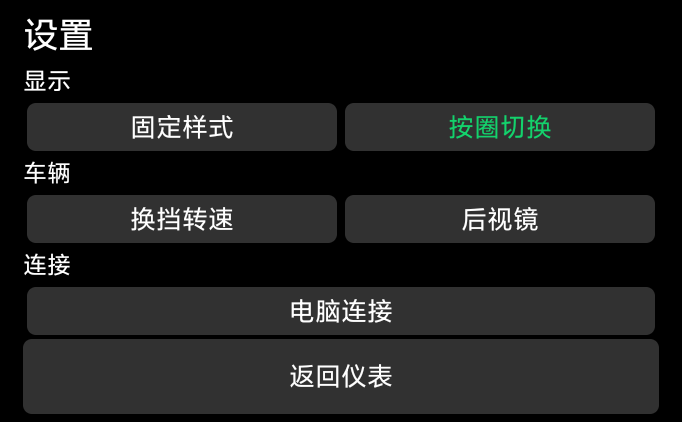
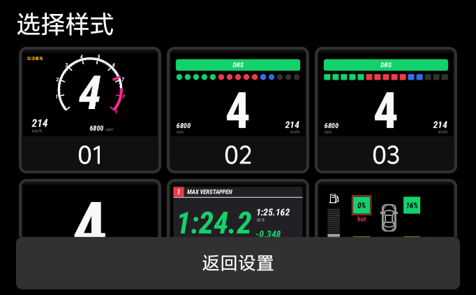
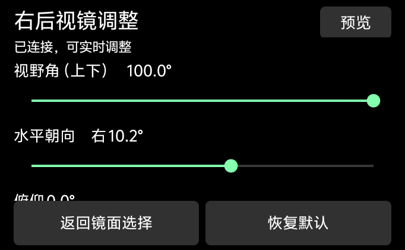
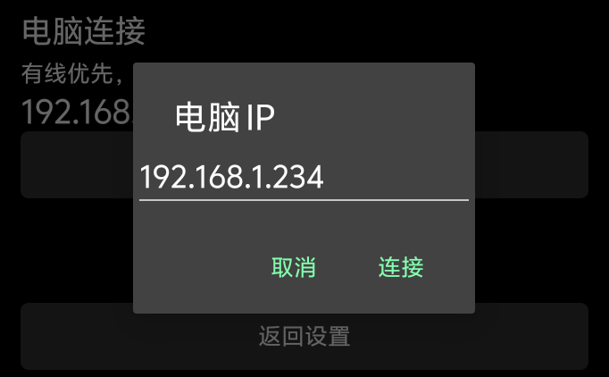

# 0.9.2 外屏缩放适配

日期：2026-10-11

设备为 vivo X Flip V2256A，Android 14。当前显示配置中的 display 1 实际为 682 × 422，逻辑密度为 160 dpi，原先验证使用 300 dpi。本次没有改写设备分辨率、密度或其它应用的显示配置

旧版设置使用系统 dp/sp，160 dpi 下文字约为原先大小的一半，按钮的大块空白与文字尺寸不协调。新版对设置和 IP 输入框使用当前 Activity 所在窗口的独立显示上下文，基准与原生仪表一致。字体、控件、滑块和缩略图一同按窗口尺寸缩放，保留系统字体倍率，长按钮文字在可用空间内缩放。设置仍留在当前 Activity 的外屏 Dialog，不要求展开或使用已拆除的内屏

最终实机安装 versionCode 16、versionName 0.9.2。设备 APK 拉回后的 SHA-256 与发布 APK 一致：e8791ca39c0746c48cf8e0e5e8f5bbd85bbc7888e2cab2cdf3f250070e9fb96c

真实外屏逐页检查设置首页、换挡转速页、编号缩略图、按圈切换、后视镜选择与调节、连接设置和 IP 输入框。按钮文字像素检查共 67 项，最小字形高度 22 像素、最小边距 12 像素，没有文字贴边或裁切。检查后恢复原镜面选择，保留原圈序、布局、电脑 IP 和换挡设置。图库为内置示例缩略图，未向游戏或手机注入模拟遥测

USB 连接恢复，监视器读取真实外屏 682 × 422、display 1、设备 V2256A。电脑桥接保留 0.9.1，其发布文件 SHA-256 为 0d61dc65570f9eaca5313682bed69f65300e6cbf8c1bc889e45a5e19d5608ae0

assembleDebug、lintDebug 与 git diff --check 通过，Lint 为 0 错误、6 项既有警告。当前 AC 未运行，没有重新进行驾驶、完圈或后视图采集验证。其它尺寸和品牌通过通用窗口比例处理，尚未逐机实测

